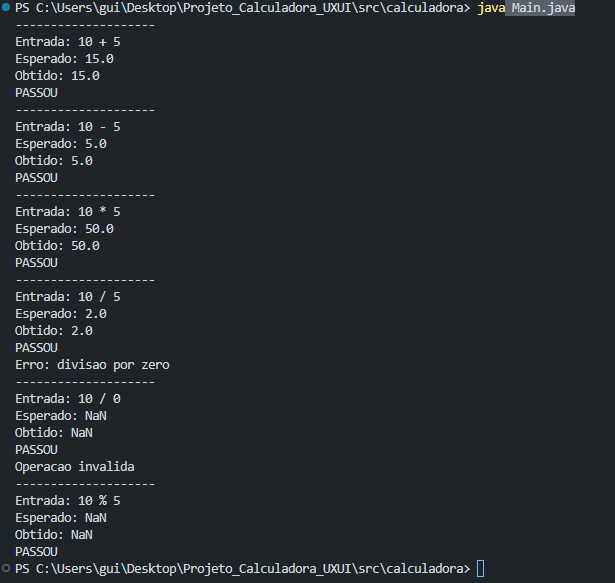
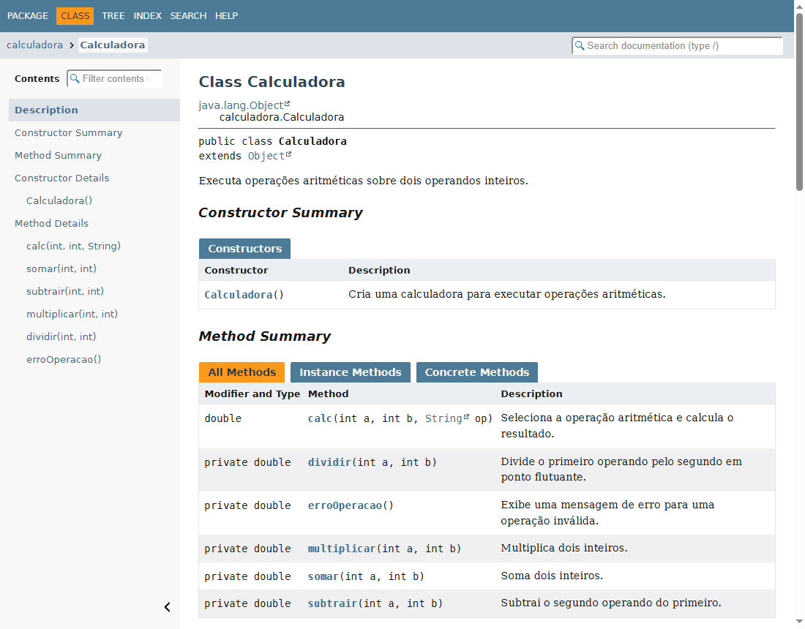

# Projeto Calculadora UX/UI

Projeto acadêmico em Java que implementa uma calculadora de operações básicas para a **FinançApp**, uma startup fictícia de finanças pessoais. A atividade simula um módulo que poderia apoiar cálculos de orçamento mensal, divisão de despesas e projeções de economia.

## Objetivo da atividade

Praticar a construção e a manutenção de software com testes funcionais e unitários, tratamento de erros, refatoração, documentação técnica e versionamento. O projeto usa testes de caixa-preta que chamam o método público da calculadora e comparam o resultado obtido com o esperado.

## Tecnologias

- **Java e JDK** para implementar, compilar e executar a calculadora.
- **JavaDoc** para gerar a documentação HTML a partir do código-fonte.
- **Git e GitHub** para versionar e hospedar o projeto.

## Operações

O método `calc(int a, int b, String op)`, da classe `Calculadora`, recebe dois inteiros e um operador e devolve um `double`.

| Operação | Operador | Exemplo | Resultado esperado |
| --- | :---: | --- | ---: |
| Soma | `+` | `10 + 5` | `15.0` |
| Subtração | `-` | `10 - 5` | `5.0` |
| Multiplicação | `*` | `10 * 5` | `50.0` |
| Divisão | `/` | `10 / 5` | `2.0` |

A divisão usa ponto flutuante para preservar a parte fracionária. Se o divisor for zero ou o operador for inválido ou nulo, a calculadora imprime uma mensagem de erro e retorna `Double.NaN`, permitindo que a execução prossiga.

## Estrutura e refatoração

- [Calculadora.java](src/calculadora/Calculadora.java) seleciona a operação e delega cada cálculo a um método privado.
- [TesteCalculadora.java](src/calculadora/TesteCalculadora.java) reúne os seis casos de teste e centraliza a comparação dos resultados.
- [Main.java](src/calculadora/Main.java) executa a suíte de testes usando o método `executarTestes()`.

A branch `main` é a principal. A branch `Refatoracao` reúne a reorganização do código, incluindo a extração das operações em métodos e a remoção dos casos de teste duplicados no `Main`.

## Como executar os testes

Com o JDK instalado, abra o PowerShell na raiz do projeto e rode os comandos abaixo.

```powershell
$fontes = Get-ChildItem .\src\calculadora\*.java | Select-Object -ExpandProperty FullName
javac -encoding UTF-8 -d out $fontes
java -cp out calculadora.Main
```

A suíte testa as quatro operações, a divisão por zero e um operador inválido. Cada caso mostra a entrada, o resultado esperado, o resultado obtido e a indicação `PASSOU` ou `FALHOU`. Em caso de divergência, a suíte sinaliza a falha com `AssertionError`.



## Documentação JavaDoc

Abra o [índice da documentação](docs/index.html) no navegador para consultar as classes, os métodos, os atributos e os contratos de cada operação. Para regenerar a documentação a partir da raiz do projeto, rode:

```powershell
javadoc -private -encoding UTF-8 -docencoding UTF-8 -charset UTF-8 -d docs -sourcepath src calculadora
Invoke-Item .\docs\index.html
```

A opção `-private` inclui os membros privados na documentação.



## Repositório

[Projeto Calculadora UX/UI no GitHub](https://github.com/JoaogDi4s/Projeto_Calculadora_UXUI)
